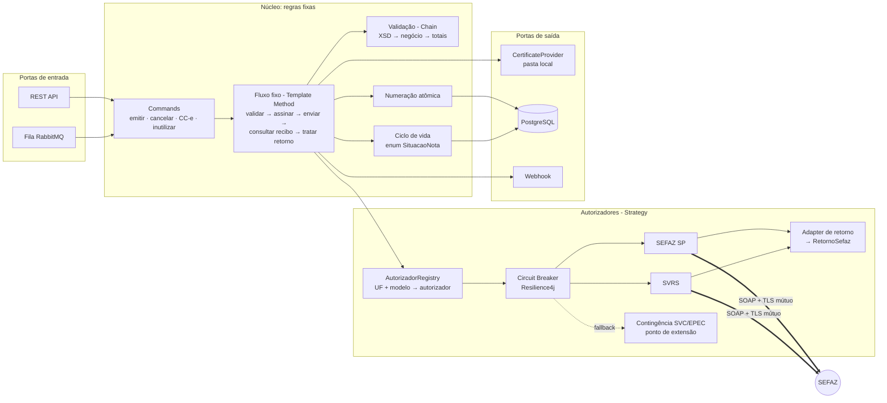
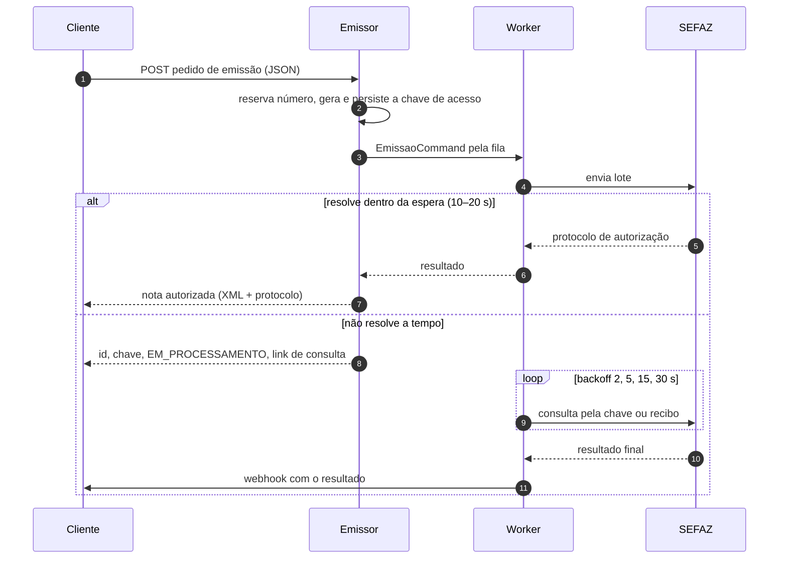

# Nota Fiscal Tupiniquim

Emissor de notas fiscais eletrônicas **open source em Java**. Um microsserviço genérico em que **entra JSON e sai nota autorizada**: ele concentra toda a comunicação com as SEFAZ para que o seu sistema não precise falar SOAP, assinar XML nem lidar com certificado.

> **Status:** em construção. Esta etapa contém só documentação e decisões de arquitetura. O código chega nas próximas etapas.

## O que é

- Um serviço que recebe os dados da nota em JSON, monta o XML, valida, assina, envia ao autorizador correto e devolve a nota autorizada (XML + protocolo).
- Um ponto único para emissão, cancelamento, carta de correção, inutilização e consultas.
- Um projeto que documenta o **porquê** de cada decisão em [ADRs](docs/adr/).

## O que não é

- **Não calcula imposto.** Os valores chegam calculados de quem chama. O emissor só **confere a matemática** (soma dos itens = total, base × alíquota = imposto, arredondamento) antes de enviar. Correção tributária é responsabilidade de quem chama. Ver [ADR-0002](docs/adr/0002-imposto-fora-do-emissor.md).
- Não é ERP, não gera DANFE e não tem interface gráfica.
- Não guarda os XMLs para sempre por conta própria: o XML autorizado e o protocolo são persistidos, mas **manter a retenção legal de 5 anos é responsabilidade de quem opera o serviço** (backup, política de retenção do banco ou do storage).

## Escopo da versão 1

| Na v1 | Fora da v1 (ponto de extensão pronto) |
|---|---|
| NF-e (modelo 55) e NFC-e (modelo 65) | CT-e, MDF-e, NFS-e e outros documentos |
| Entrada por REST e por fila (RabbitMQ) | gRPC e entrada por XML pronto |
| Autorizadores SEFAZ SP e SVRS | Demais autorizadores |
| Certificado A1 em pasta local | Cofre de certificados (Vault, AWS) |
| Circuit Breaker com ponto de contingência preparado | Contingência SVC/EPEC efetiva |
| — | Interface gráfica |

Detalhes e justificativa em [ADR-0001](docs/adr/0001-escopo-v1.md).

## Arquitetura

Hexagonal: REST e fila são portas de entrada que chegam ao mesmo motor. O núcleo aplica as regras que valem para todo autorizador; o que muda entre autorizadores fica numa Strategy escolhida por um Registry.



### Modelo híbrido de resposta

A chamada espera um tempo curto e configurável. Se a SEFAZ resolver nesse prazo, a nota autorizada volta na própria resposta. Se não, a resposta traz o identificador, a chave de acesso, a situação `EM_PROCESSAMENTO` e o link de consulta; o resultado final chega por webhook. Em timeout, o emissor **nunca reenvia no escuro**: consulta pela chave de acesso. Ver [ADR-0006](docs/adr/0006-envio-assincrono-idempotencia-modelo-hibrido.md).



### Decisões

Todas as decisões estão em [`docs/adr/`](docs/adr/), cada uma com contexto, opções, decisão e consequências. Os termos fiscais usados no código estão no [glossário](docs/glossario.md).

## Como rodar

> Os comandos abaixo passam a funcionar a partir da **Etapa 2** (primeiro código). Hoje o repositório tem só documentação.

### Pré-requisitos

- JDK 21
- Maven 3.9+
- Docker e Docker Compose (PostgreSQL e RabbitMQ)
- Certificado A1 (`.pfx`) do emitente, válido para **homologação**

### Passos

1. Copie a configuração de exemplo e preencha:

   ```bash
   cp .env.example .env
   ```

2. Coloque o certificado numa subpasta com o CNPJ do emitente, sem pontuação:

   ```text
   .certificados/
   └── 12ABC34501DE35/
       └── certificado.pfx
   ```

   E a senha no `.env`:

   ```dotenv
   CNPJ_12ABC34501DE35=senha-do-pfx
   ```

   Filiais sem pasta própria usam o certificado da matriz, encontrado pela raiz do CNPJ (8 primeiros caracteres). Ver [ADR-0008](docs/adr/0008-certificado-por-cnpj-pasta-local.md).

3. Suba as dependências e o serviço:

   ```bash
   docker compose up -d
   ./mvnw spring-boot:run
   ```

## Segurança

> [!WARNING]
> **Nunca faça commit de `.certificados/` nem do `.env`.** Os dois já estão no [`.gitignore`](.gitignore), assim como `*.pfx` e `*.p12` em qualquer pasta. Um certificado vazado permite emitir notas em nome da empresa. Se isso acontecer, revogue o certificado junto à autoridade certificadora imediatamente.

- O certificado é lido só para memória e nunca é gravado em disco fora de `.certificados/`.
- O ambiente padrão é **homologação**. Produção exige `AMBIENTE=PRODUCAO` **e** `PRODUCAO_CONFIRMED=true`.
- **Testes nunca rodam em produção.** A suíte de testes recusa iniciar se o ambiente for produção.

## Contribuindo

Leia o [CONTRIBUTING.md](CONTRIBUTING.md): mapa da arquitetura, como adicionar um autorizador, regras inegociáveis e padrão de commits.

## Licença

[MIT](LICENSE).
