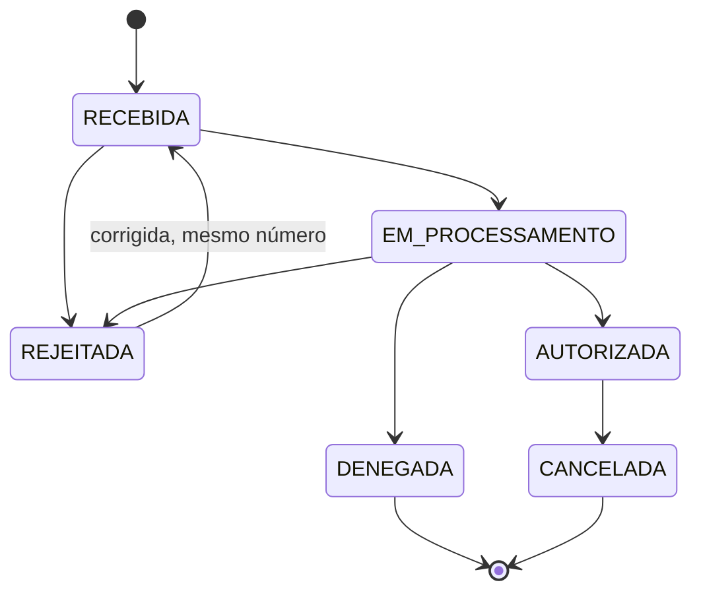

# ADR-0005: Patterns do núcleo e ciclo de vida como enum

- **Status:** Aceito
- **Data:** 2026-10-21

## Contexto

O fluxo de envio é o mesmo para todo autorizador; o que varia são endereços, versões e o formato do retorno. A validação tem etapas com custo crescente. As operações (emitir, cancelar, corrigir, inutilizar) precisam viajar pela fila. A SEFAZ fica indisponível às vezes. Sem uma estrutura clara, essas variações viram `if` espalhado.

## Opções consideradas

1. **Código procedural com condicionais por autorizador e operação.** Rápido no começo, frágil a cada autorizador novo.
2. **Um conjunto pequeno de patterns, cada um resolvendo um eixo de variação.**

## Decisão

Opção 2. Cada pattern responde a uma pergunta específica:

| Pattern | Onde | Por quê |
|---|---|---|
| **Strategy** | `Autorizador` | URLs, versões e particularidades variam por autorizador ([ADR-0004](0004-modelar-por-autorizador.md)). |
| **Registry** | `AutorizadorRegistry` | Escolhe a Strategy pela UF e modelo. |
| **Adapter** | Retorno da SEFAZ → `RetornoSefaz` | O núcleo só conhece quatro resultados: `AUTORIZADA`, `REJEITADA`, `DENEGADA`, `EM_PROCESSAMENTO`. Cada autorizador traduz seu retorno. |
| **Template Method** | Fluxo de envio | Ordem fixa: validar → assinar → enviar → consultar recibo → tratar retorno. Subclasses e Strategies preenchem passos, nunca reordenam. "Consultar recibo" é pulado quando o autorizador responde de forma síncrona. |
| **Chain of Responsibility** | Validação | Schema XSD → regras de negócio → conferência de totais ([ADR-0002](0002-imposto-fora-do-emissor.md)). Cada elo pode interromper a cadeia, e o mais barato e genérico vem antes. |
| **Command** | `EmissaoCommand`, `CancelamentoCommand`, `CartaCorrecaoCommand`, `InutilizacaoCommand` | Operação serializável: o mesmo objeto sai da porta REST ou da fila e é processado pelo worker ([ADR-0003](0003-arquitetura-hexagonal.md)). |
| **Circuit Breaker** | Chamadas ao autorizador, via Resilience4j | Para de insistir num autorizador fora do ar. A consulta de status do serviço alimenta o estado do circuito. O fallback para contingência (SVC/EPEC) fica **preparado, sem implementação** na v1. |

### Ciclo de vida: enum com transições, não State pattern

A situação da nota é o enum `SituacaoNota`. Cada valor declara para quais valores pode ir, e qualquer transição fora dessa lista lança exceção.

Por que não uma classe por estado (State pattern):

- Os estados **não têm comportamento próprio**. Quem age são os Commands e o fluxo; a situação só registra onde a nota está.
- Com enum, **todas as transições ficam num lugar só**, fáceis de auditar e de testar exaustivamente (todo par origem × destino).
- Persistir e serializar um enum é trivial. Uma hierarquia de classes de estado exigiria mapeamento extra no banco e na fila.
- Carta de correção é evento e **não muda** a situação.

## Consequências

- Cada eixo de variação tem um lugar óbvio no código, o que facilita a receita de "como adicionar um autorizador".
- O número de patterns é fechado. Pattern novo exige ADR.
- Se um estado ganhar comportamento real no futuro, a troca para State pattern é um novo ADR.
- A lista de valores de `SituacaoNota` acima é a base; a definitiva sai na etapa do domínio e é registrada no [glossário](../glossario.md).
