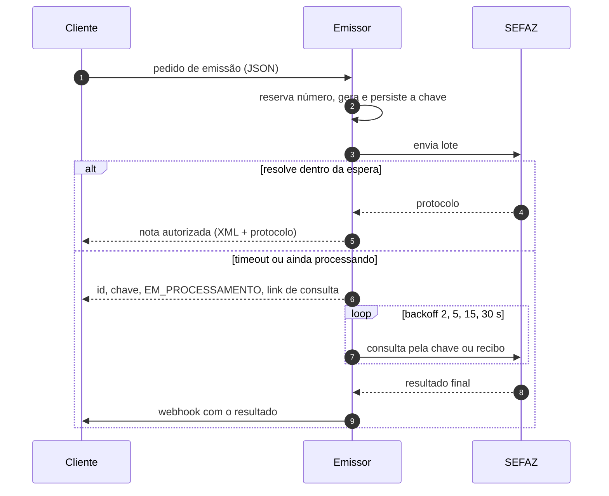

# ADR-0006: Envio assíncrono, idempotência pela chave e modelo híbrido

- **Status:** Aceito
- **Data:** 2026-10-21

## Contexto

A SEFAZ pode responder em menos de um segundo ou demorar muito, pode processar o lote de forma síncrona ou devolver um recibo para consulta posterior, e pode cair no meio da chamada. Um timeout **não diz** se a nota foi autorizada. Reenviar sem saber pode gerar rejeição por duplicidade ou, pior, deixar o sistema sem o protocolo de uma nota que vale. Consultar com frequência demais gera rejeição por consumo indevido. Ao mesmo tempo, quem chama (um PDV, por exemplo) quer a nota autorizada na mesma chamada sempre que possível.

## Opções consideradas

1. **Totalmente síncrono.** Simples para quem chama, mas prende conexões por tempo indeterminado e não sobrevive a timeout.
2. **Totalmente assíncrono.** Robusto, mas obriga todo cliente a implementar webhook ou polling, mesmo quando a SEFAZ responde em 1 s.
3. **Híbrido:** espera curta e configurável; se não resolver, devolve o identificador e segue em segundo plano.

## Decisão

Opção 3, com estas regras:

**Idempotência pela chave de acesso.**
- A chave de acesso é gerada **uma vez**, no recebimento, e persistida antes do primeiro envio. Ela é a chave de idempotência de todo o fluxo.
- **Nunca reenviar no escuro.** Em timeout ou erro de rede, o próximo passo é sempre consultar a situação pela chave de acesso. Só se a SEFAZ disser que a nota não existe o envio é refeito, com a mesma chave.
- **Duplicidade não é erro.** Se a SEFAZ responder duplicidade, o fluxo consulta pela chave e recupera o protocolo existente.
- **Sem protocolo de autorização a nota não vale.** Nenhuma resposta ao cliente diz "autorizada" sem protocolo persistido.

**Modelo híbrido de resposta.**
- A chamada espera até `SYNC_WAIT_SECONDS` (padrão 15 s, faixa sugerida 10–20 s).
- Resolveu no prazo: devolve a nota autorizada (XML + protocolo), ou a rejeição com `cStat` e `xMotivo`.
- Não resolveu: devolve **na hora** o identificador, a chave de acesso, a situação `EM_PROCESSAMENTO` e o link de consulta. O worker continua.
- O resultado final sai por **webhook** e pela **consulta de situação**.

**Consulta com backoff crescente.** Intervalos configuráveis em `CONSULTA_BACKOFF_SECONDS` (padrão 2, 5, 15, 30 s; o último se repete até o limite de tentativas). As esperas são agendadas pela fila (mensagem com atraso), sem prender thread.

## Consequências

- Clientes simples recebem a nota na própria chamada na maior parte dos casos; clientes robustos usam webhook.
- O estado `EM_PROCESSAMENTO` é visível e consultável a qualquer momento.
- Gerar a chave antes de enviar impede que a mesma nota seja reenviada com outra chave, o que a SEFAZ trataria como duplicidade com diferença na chave.
- O webhook é entregue **pelo menos uma vez**: o cliente deve tolerar entrega repetida.
- **A confirmar:** como o cliente evita criar duas notas ao repetir o mesmo pedido HTTP (proposta: identificador do pedido fornecido pelo cliente, único por CNPJ do emitente).
- **A confirmar:** autenticação da chamada de webhook (proposta: assinatura HMAC no cabeçalho).
- **A confirmar:** limite total de tentativas de consulta antes de escalar para análise manual.
